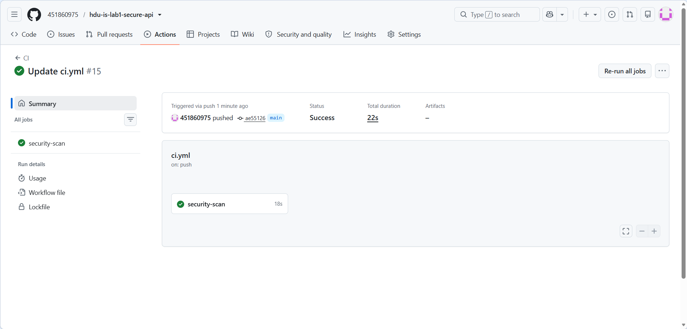
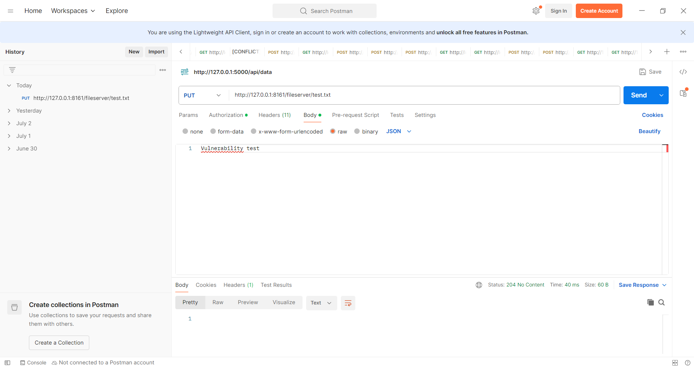
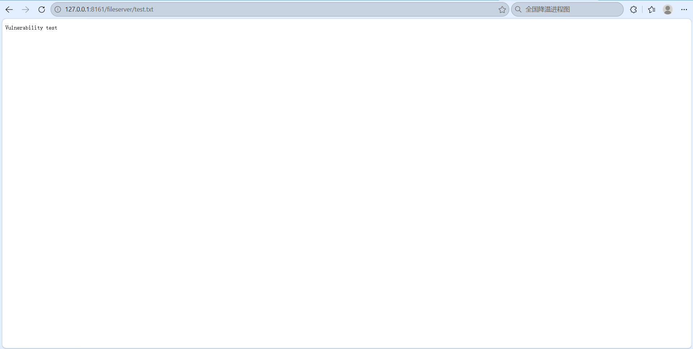
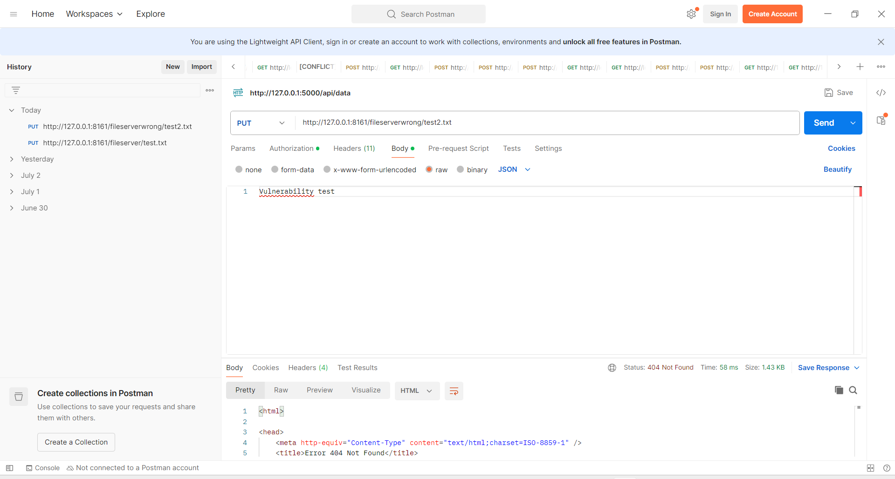

# Lab1: Secure REST API & CVE Vulnerability Reproduction
Name: Yu Jiawen
Student ID: 23320304

## Lab Purpose
Build a secure Flask REST API with protection against OWASP Top10 risks, integrate GitHub Actions CI/CD security scanning(SAST & SCA). Reproduce a real CVE vulnerability, analyze its root‑cause, propose fix and verify remediation effect using vulhub docker environment.

## Project & API Description
This project uses Python Flask framework, SQLite as in‑memory database.
Implemented API endpoints:
1. `POST /auth/login`
    - Function: User login, verify username and password, return JWT token for authenticated access.
    - Request body example: `{"username":"test","password":"mypassword"}`
2. `GET /api/data`
    - Function: Return protected user data list. **Requires valid JWT token in request header `Authorization: Bearer <token>`**. Access will be rejected without token.
3. `GET /api/public-info`
    - Function: Extra self‑designed public endpoint, return public system information, no authentication required.

## Implemented Security Measures
1. **SQL Injection protection**
    Use SQLAlchemy ORM to interact with SQLite database. All database queries use ORM parameterized query, avoid manual string concatenation for SQL statements. Prevent SQL injection attacks.

2. **XSS protection**
    All user‑controlled input data is escaped before returning in API JSON responses. Flask built‑in escaping mechanism is used to avoid cross‑site‑scripting risks.

3. **Broken Authentication mitigation**
    - When login succeeds, server issues JWT token to client.
    - Custom middleware validates JWT signature and expiration for every protected `/api/*` route. Request without valid JWT will get 401 Unauthorized response.
    - User passwords are **never stored as plaintext**. Password is hashed by bcrypt before saving into database. Plain password will not be persisted.

## CI / CD Pipeline (GitHub Actions)
File path: `.github/workflows/ci.yml`
- **SAST(Static Application Security Testing): bandit**
    Static source‑code security scanner for Python code, detect insecure coding patterns.
- **SCA(Software Composition Analysis): safety**
    Scan project third‑party dependencies, detect known vulnerabilities in pip packages.

Every `git push` or pull request will trigger this workflow automatically.

CI pipeline successful run screenshot:

> Link of last successful pipeline run: [https://github.com/451860975/hdu-is-lab1-secure-api/actions/runs/39362629270]

## Selected CVE: CVE‑2016‑3088 Apache ActiveMQ Arbitrary File Write Vulnerability
### Vulnerability description
Apache ActiveMQ contains an unauthenticated file server endpoint `/fileserver`. Attackers can send HTTP PUT requests to upload arbitrary files to the server. If attackers upload malicious JSP webshell files, they can achieve remote code execution on the host.

### Reproduction steps
1. Start the vulnerable environment with `docker‑compose up -d`
2. Use Postman to send PUT request to `http://127.0.0.1:8161/fileserver/test.txt`, the request body contains custom text.
3. The server returns HTTP 204 No Content. The uploaded file can be directly accessed via browser, which proves the arbitrary file write vulnerability exists.

Postman result of vulnerable request:

Browser preview of uploaded file:

### Root‑cause analysis
The fileserver web application is enabled in jetty.xml by default without authentication. It accepts HTTP PUT requests and writes user‑controllable content directly to the server disk. There is no filter to block executable script files.

### Applied Fix
Edit jetty.xml configuration file and comment out the entire fileserver webapp configuration block. After restarting ActiveMQ service, the `/fileserver` web endpoint will be removed.

### Verification of the fix
After applying the patch:
1. Send the same PUT upload request to `/fileserver` again. The server returns HTTP 404 Not Found. The file upload function is disabled.
2. Regression test: Access ActiveMQ homepage `http://127.0.0.1:8161`. The web management page works normally, and the core message queue service is unaffected.

Fix verification screenshot:

